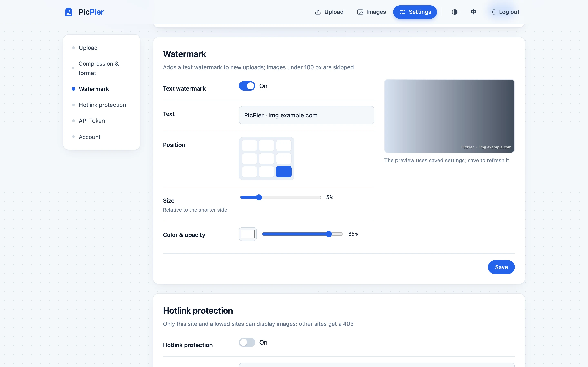
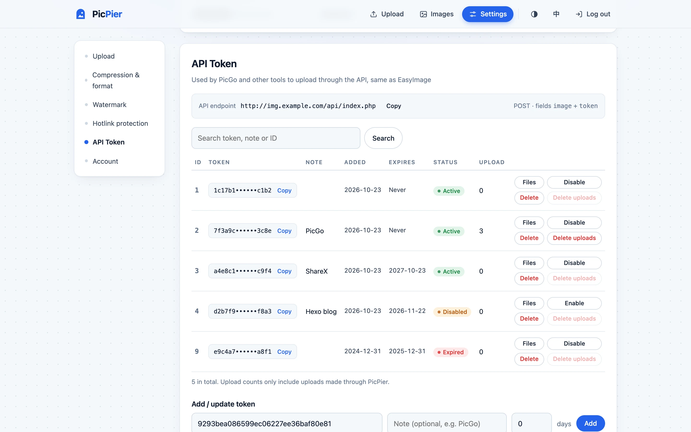
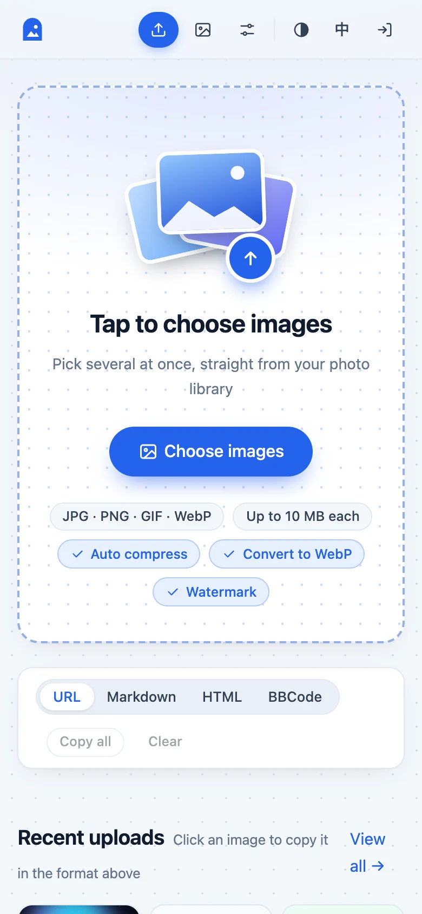
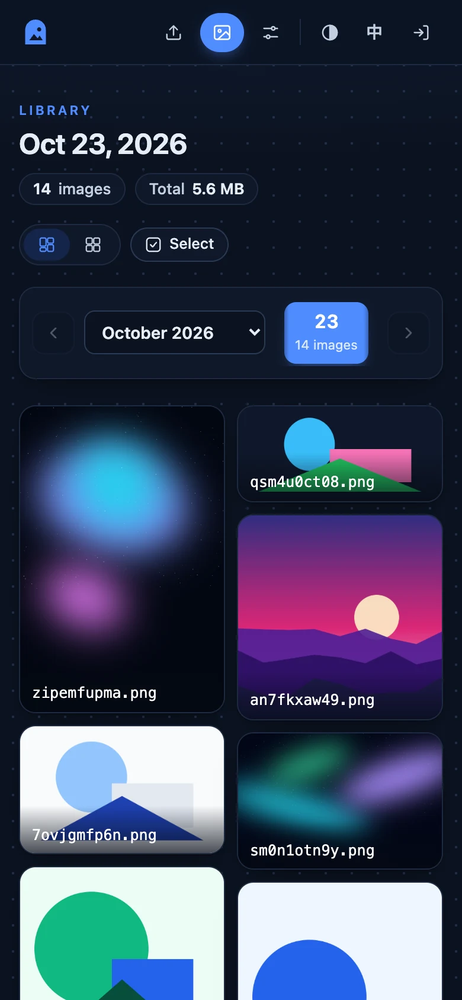

<p align="center"></p>

<h1 align="center">PicPier · 图栈</h1>

<p align="center"><b>A pier for your pictures</b> · a lightweight self-hosted image host, no PHP, no database</p>

<p align="center"><a href="README.md">简体中文</a> · <b>English</b></p>

<p align="center">
  <a href="https://github.com/Lau0x/picpier/releases/latest"></a>
  <a href="LICENSE"></a>
  <a href="https://github.com/Lau0x/picpier/pkgs/container/picpier"></a>
  
  
</p>

<p align="center">
  <a href="#quick-start-docker-fresh-install">Quick start</a> ·
  <a href="#migrating-from-easyimage">Migrate from EasyImage</a> ·
  <a href="#settings">Settings</a> ·
  <a href="#upload-tools">PicGo</a> ·
  <a href="#screenshots">Screenshots</a>
</p>

<p align="center"></p>

PicPier is an image host for your own pictures. It runs as a single binary or a single Docker container, with no PHP, database or runtime to install. Drop in an image, get a link, and paste it into your blog, forum post or newsletter.

If you're running [EasyImage 2.0](https://github.com/icret/EasyImages2.0), you can switch over in place: PicPier uses the same image directory, so **every link you've already shared keeps working**, and PicGo and other upload tools need no changes. See [Migrating from EasyImage](#migrating-from-easyimage).

## Features

**Upload and share**
- Drag and drop, paste screenshots, or pick several files at once, with progress bars and up to 3 parallel uploads
- Copy as URL / Markdown / HTML / BBCode in one click, or copy every link from a batch at once
- Recent uploads on the upload page, click one to copy it
- Compatible with the EasyImage upload API (`/api/index.php`, fields `image` + `token`), so PicGo, ShareX and other tools work as is

**Image processing**
- Compress and convert to WebP on upload; the original is kept if processing makes it larger
- Text watermark with a live preview, shipping with Noto Sans SC Bold so Latin and 6,763 common Chinese characters work out of the box
- Photos are rotated upright from EXIF, and location data is stripped when re-encoding

**Management**
- Browse by date in a masonry layout that keeps each image's aspect ratio, or switch to a grid
- Select several images to copy their links or delete them; the lightbox supports left/right arrow keys
- Deleted images go to a trash folder, so mistakes can be undone
- API tokens: expiry, disabling, viewing and deleting the images a token uploaded, and one-click import of EasyImage tokens

**Security**
- Never executes uploaded content; formats are detected from file contents, so scripts disguised as images are rejected
- Hotlink protection with a Referer allowlist, including wildcard subdomains
- Admin password stored as a salted hash; changing it logs out other devices; repeated failed logins trigger a temporary lockout

**Deployment**
- One executable, a Docker image of about 25 MB, amd64 and arm64
- Chinese and English interface, picked from the browser language and switchable in the top right corner
- Light and dark themes that follow the system by default and can be switched manually; works well on phones

> PicPier is an independent project and is not affiliated with EasyImage or its author [icret](https://github.com/icret). It follows EasyImage's directory layout and upload API to make migration easy, and reuses none of its code.

## Screenshots

<table>
  <tr>
    <td width="50%"><p align="center">Library: browse by date in a masonry layout</p></td>
    <td width="50%"><p align="center">Lightbox: dimensions, size, one-click copy</p></td>
  </tr>
  <tr>
    <td><p align="center">Watermark: built-in CJK font, live preview</p></td>
    <td><p align="center">API tokens: expiry, disabling, upload counts</p></td>
  </tr>
  <tr>
    <td><p align="center">Dark mode: follows the system or set manually</p></td>
    <td><p align="center"> </p><p align="center">Works on phones too</p></td>
  </tr>
</table>

## Why not PHP

PHP2Shell (CVE-2026-109618 / CVE-2026-109619), a PHP core vulnerability disclosed in October 2026, allows unauthenticated remote code execution. According to CISA, every PHP installation that handles web requests is affected, and it is being actively exploited ([CISA alert](https://www.cisa.gov/news-events/alerts/2026/10/21/critical-vulnerabilities-php-require-immediate-patching)).

EasyImage 2.8.6 and earlier also have their own vulnerabilities, including arbitrary file upload ([CVE-2025-65471](https://osv.dev/vulnerability/CVE-2025-65471)) and code execution via file renaming ([CVE-2025-65474](https://nvd.nist.gov/vuln/detail/CVE-2025-65474)). As of October 2026 there is no official fix.

An image host really only needs to receive files, store them and serve them. PicPier does those three things in Go and drops PHP entirely; images can be served by Nginx / OpenResty as plain static files.

## Quick start (Docker, fresh install)

```bash
mkdir picpier && cd picpier
curl -fsSLO https://raw.githubusercontent.com/Lau0x/picpier/main/docker-compose.yml
curl -fsSL https://raw.githubusercontent.com/Lau0x/picpier/main/.env.example -o .env
mkdir -p data && sudo chown 1000:1000 data
```

Generate a signing secret and an API token (for PicGo and similar tools):

```bash
sed -i "s/^PICPIER_SECRET=.*/PICPIER_SECRET=$(openssl rand -hex 32)/" .env
sed -i "s/^PICPIER_TOKENS=.*/PICPIER_TOKENS=$(openssl rand -hex 16)/" .env
```

Then edit `.env`: set `PICPIER_BASE` to your image host's URL and `PICPIER_PASSWORD` to a long admin password.

```bash
chmod 600 .env
docker compose up -d
docker compose ps        # STATUS should show healthy
```

The container only listens on `127.0.0.1:18321`. Put Nginx / OpenResty / Caddy in front of it with HTTPS, see [Reverse proxy](#reverse-proxy).

## Migrating from EasyImage

Migration doesn't copy or modify any image files. PicPier reads and writes the existing `i` directory directly, so old links keep working, and you can switch back to EasyImage at any point.

EasyImage is usually deployed in one of two ways, and the steps differ:

- **Docker** (`docker ps` shows an image like `ddsderek/easyimage`): follow [EasyImage on Docker](#easyimage-on-docker). It's the simplest path and your reverse proxy needs no changes.
- **PHP site** (a PHP website created in 1Panel, aaPanel/BT or similar): start from [1. Back up](#1-back-up).

### EasyImage on Docker

The idea is to put PicPier in EasyImage's directory, use the existing `i` directory and take over the same port, so Nginx Proxy Manager or any other reverse proxy stays as it is. The example below uses `/root/data/docker_data/img.example.com`, which contains `docker-compose.yml`, `config`, `i` and possibly `images`:

```bash
cd /root/data/docker_data/img.example.com

# 1. Back up
tar czf ~/easyimage-backup-$(date +%F).tgz .

# 2. Look for planted backdoors: list files that aren't images (except EasyImage's own cache folders). If anything shows up, stop and investigate
find i images -type f ! -path 'i/cache/*' ! -path 'i/thumbnails/*' ! -iregex '.*\.\(jpe?g\|png\|gif\|webp\|bmp\|ico\|avif\|svg\)' 2>/dev/null

# 3. Note two things: the owner of the image directory, and EasyImage's public port (the number left of the colon in PORTS)
stat -c '%u:%g' i
docker compose ps

# 4. Stop EasyImage (stop only, don't remove) and keep the old files for rollback
docker compose stop
mv docker-compose.yml docker-compose.easyimage.yml
mv config config.easyimage
sed -i 's#\./config:#./config.easyimage:#' docker-compose.easyimage.yml
```

Create a new `docker-compose.yml`. Set `user` to the owner from step 3 and the left side of `ports` to EasyImage's old port; drop the `images` line if you don't have that directory:

```yaml
name: picpier

services:
  picpier:
    image: ghcr.io/lau0x/picpier:latest
    container_name: picpier
    restart: unless-stopped
    user: "1000:1000"
    env_file: .env
    ports:
      - "9000:18321"
    volumes:
      - ./i:/data/i
      - ./images:/data/images:ro
      - ./i-trash:/data/i-trash
      - ./config:/data/config
```

Keep `name: picpier`. Without it, Docker groups this and the old EasyImage container into one project by directory name, warns about "orphan containers", and `--remove-orphans` would delete the old container.

Download `.env.example` as `.env` and fill it in:

```bash
curl -fsSL https://raw.githubusercontent.com/Lau0x/picpier/main/.env.example -o .env
```

- `PICPIER_BASE`: your existing image host URL
- `PICPIER_PASSWORD`, `PICPIER_SECRET`: admin password and signing secret (`openssl rand -hex 32`)
- `PICPIER_EXTRA_DIRS=images=/data/images`: add this if you have an `images` directory
- `PICPIER_TRUSTED_PROXIES`: if the reverse proxy runs on another server, add its IP as described in `.env.example`
- `PICPIER_IMAGE_CORS=off`: set this if your reverse proxy already adds a CORS header, see [Only one CORS header](#only-one-cors-header)

Then start it:

```bash
mkdir -p i-trash config && sudo chown <owner from step 3> i-trash config
chmod 600 .env
docker compose up -d
docker compose ps        # STATUS should show healthy
```

Finally, log in to the admin, open "Settings → API Token → Import from EasyImage", paste the contents of `config.easyimage/api_key.php`, and run through [7. Verify](#7-verify).

To roll back to EasyImage:

```bash
docker compose down && docker compose -f docker-compose.easyimage.yml up -d
```

Once everything has been fine for a few days, you can remove the old container (files are kept): `docker compose -f docker-compose.easyimage.yml down`.

### PHP site

Below, `<site root>` means the EasyImage directory, the one containing `i`, `config`, `api` and so on. Common locations:

| Environment | Site root on the host |
| --- | --- |
| 1Panel | `/opt/1panel/apps/openresty/openresty/www/sites/<domain>/index` |
| aaPanel / BT | `/www/wwwroot/<domain>` |
| Your own Nginx | the `root` in the site config |

### 1. Back up

```bash
tar czf ~/easyimage-backup-$(date +%F).tgz -C <site root> .
```

### 2. Look for planted backdoors

EasyImage's vulnerabilities allow uploading executable files. Before migrating, check the image directory for anything that isn't an image:

```bash
find <site root>/i -type f ! -iregex '.*\.\(jpe?g\|png\|gif\|webp\|bmp\|ico\|avif\|svg\)'
```

If this prints anything (especially `.php`, `.phtml` or `.phar`), the server may already be compromised. Don't just swap the software: treat the server as breached, check other sites, rotate every password and key, and reinstall if needed.

PicPier never executes or serves these files, but they still exist on the host.

### 3. Save your existing API tokens

If you upload through the API with PicGo, ShareX or similar tools, copy the token file now; you'll paste it into the new admin in step 7:

```bash
cat <site root>/config/api_key.php
```

Imported tokens keep their IDs, creation dates and expiry, so nothing changes on the tool side.

### 4. Check the image directory's owner

```bash
stat -c '%u:%g' <site root>/i
```

Note the two numbers, e.g. `1000:1000`. PicPier must run as the same user to write new images into the existing directory.

### 5. Start PicPier

**Option 1: Docker (recommended)**

```bash
mkdir ~/picpier && cd ~/picpier
curl -fsSLO https://raw.githubusercontent.com/Lau0x/picpier/main/docker-compose.yml
curl -fsSL https://raw.githubusercontent.com/Lau0x/picpier/main/.env.example -o .env
```

Edit `docker-compose.yml` so `volumes` mounts the existing `i` directory:

```yaml
    volumes:
      - <site root>/i:/data/i
      - ./i-trash:/data/i-trash
      - ./config:/data/config
```

The `config` directory holds settings, tokens and the upload log. Always mount it, or it's lost when the container is recreated.

If the site root also has an `images` directory (used by early EasyImage versions, with links like `/images/2021/...`), add a read-only mount and set `PICPIER_EXTRA_DIRS=images=/data/images` in `.env` so those links keep working too:

```yaml
      - <site root>/images:/data/images:ro
```

Edit `.env`: set `PICPIER_BASE` to your existing URL (e.g. `https://img.example.com`), `PICPIER_UID` / `PICPIER_GID` to the numbers from step 4, and fill in the password and secret. `PICPIER_TOKENS` can stay empty. Then:

```bash
mkdir -p i-trash config && sudo chown <numbers from step 4> i-trash config
chmod 600 .env
docker compose up -d
curl -s http://127.0.0.1:18321/healthz     # prints ok when healthy
```

**Option 2: Run directly (systemd)**

Download the binary for your architecture from [Releases](https://github.com/Lau0x/picpier/releases) (`uname -m` shows `x86_64` for amd64, `aarch64` for arm64):

```bash
sudo install -m 755 picpier-linux-amd64 /usr/local/bin/picpier
sudo cp .env.example /etc/picpier.env && sudo chmod 600 /etc/picpier.env   # then edit it
sudo mkdir -p <site root>/i-trash <site root>/picpier-config
sudo chown <numbers from step 4> <site root>/i-trash <site root>/picpier-config
```

Copy [deploy/picpier.service](deploy/picpier.service) to `/etc/systemd/system/`, change the paths to your `<site root>`, and set `User` / `Group` to the image directory's owner. Then:

```bash
sudo systemctl daemon-reload
sudo systemctl enable --now picpier
curl -s http://127.0.0.1:18321/healthz
```

### 6. Update the reverse proxy and retire PHP

Replace the site config as described in [Reverse proxy](#reverse-proxy). **Remove every PHP-related directive**, including `location ~ \.php$`, `fastcgi_pass`, `include enable-php-*.conf` and `index index.php`. If even one remains, PHP requests are handed to PHP and bypass PicPier.

```bash
nginx -t && nginx -s reload          # 1Panel reloads automatically when you save in the panel
```

### 7. Verify

```bash
# An old image: should return 200 and image/...
curl -sI https://img.example.com/i/<path to an old image> | head -3
# A script in the upload directory: should return 404
curl -s -o /dev/null -w '%{http_code}\n' https://img.example.com/i/test.php
# API and token: sending only a token writes no file. Expect "没有选择上传的文件" (no file selected); "Token 错误" means the token wasn't imported
curl -s -F token=<your token> https://img.example.com/api/index.php
```

Then open `https://img.example.com`, log in with the new password, go to "Settings → API Token → Import from EasyImage", paste the `api_key.php` contents from step 3 and import (then run the API check again). Upload one image from the web page and one from PicGo to confirm. Compression, WebP, watermark and hotlink protection can be turned on under "Settings".

### 8. Clean up

Once everything works:

- Stop PHP for this site (in 1Panel, delete or disable its PHP runtime; in aaPanel/BT, set the site's PHP version to "static")
- Move EasyImage's program files out of the site directory and keep only `i`. You already have the backup from step 1
- If the server hosts other PHP sites, upgrade PHP to a fixed release (8.5.12 / 8.4.27 / 8.3.36 / 8.2.35 or later)

### What changes after migrating

| Item | Status |
| --- | --- |
| `/i/...` image links | Unchanged |
| `/year/month/day/file` links with "hide /i/ path" enabled | Unchanged |
| `/images/...` links from early versions | Unchanged, requires `PICPIER_EXTRA_DIRS` |
| `thumb.php?img=...` thumbnail links | Redirect to the original |
| `/api/index.php` uploads | Unchanged, same response format |
| Old delete links `del.php?hash=...` | **Stop working**; new uploads return new delete links |
| API tokens (ID, expiry, disabled) | Supported, one-click import from `api_key.php` |
| Compression, WebP, text watermark, hotlink protection | Supported, enable under "Settings" |
| Original-image protection links `hide.php?key=...` | **Not supported**; old links of this kind stop working |
| Image watermarks, NSFW detection, FTP sync, guest uploads, multiple users | Not supported |
| Upload formats | New uploads accept jpg / png / gif / webp only; existing bmp / ico / svg files are still served |

## Reverse proxy

The full config is in [deploy/nginx.conf](deploy/nginx.conf) and works with both Nginx and OpenResty. The essential parts:

```nginx
client_max_body_size 12m;

# Nginx serves images directly, no program involved; anything that isn't an image is 404
location ^~ /i/ {
    root <site root as seen by OpenResty>;
    location ~* \.(jpe?g|png|gif|webp|bmp|ico|avif)$ { expires 30d; try_files $uri =404; }
    return 404;
}

# Old .php URLs (api/index.php, thumb.php) are handled by PicPier
location ~* \.php$ { proxy_pass http://127.0.0.1:18321; proxy_set_header Host $host; proxy_set_header X-Real-IP $remote_addr; }

location / { proxy_pass http://127.0.0.1:18321; proxy_set_header Host $host; proxy_set_header X-Real-IP $remote_addr; }
```

Notes:

- **1Panel**: OpenResty runs in a container, so `root` must be the in-container path `/www/sites/<domain>/index`, not the host's `/opt/1panel/...`. 1Panel's OpenResty uses host networking by default, so `127.0.0.1:18321` is reachable.
- **Fresh installs**: if Nginx can't read the image directory, skip the `/i/` block and proxy everything to PicPier, which serves images itself. Simpler, slightly slower.
- **Keep the `Host` and `X-Real-IP` lines**: the first is used for the cross-site request check, the second for per-IP login rate limiting.
- **Caddy**: `reverse_proxy 127.0.0.1:18321` is enough, since Caddy passes Host by default. Add `header_up X-Real-IP {remote_host}`.

### Nginx Proxy Manager

Just forward the domain to PicPier in a Proxy Host; PicPier serves the images too, so the Nginx config above isn't needed. NPM passes `Host` and `X-Real-IP` by default. Three things to watch:

- **Port**: the repository's `docker-compose.yml` listens on `127.0.0.1:18321` only. If NPM runs on another server, or in Docker where it can't reach the host's 127.0.0.1, change `ports` to `"18321:18321"` (or take over the old port) and firewall it so only NPM's IP can connect.
- **Trusted proxies**: no change needed when NPM and PicPier run in Docker on the same machine. If NPM is on another server, add its IP to `PICPIER_TRUSTED_PROXIES`. Otherwise every visitor looks like the same IP, and a few wrong passwords from anyone lock everyone out of the admin for 15 minutes.
- **Custom config**: if you added `Access-Control-Allow-Origin` under Custom Nginx Configuration, set `PICPIER_IMAGE_CORS=off`, see [Only one CORS header](#only-one-cors-header).

### Hotlink protection

Hotlink protection checks the `Referer` header in PicPier, so image requests must reach PicPier for it to work:

- **Your proxy forwards every request to PicPier** (the usual setup with Nginx Proxy Manager, Caddy, aaPanel reverse proxy and so on): no changes needed, it works as soon as you enable it.
- **Nginx serves `/i/` directly, as in the recommended config above**: requests never reach PicPier, so proxy `/i/` as well:

```nginx
location ^~ /i/ {
    proxy_pass http://127.0.0.1:18321;
    proxy_set_header Host $host;
    proxy_set_header X-Real-IP $remote_addr;
}
```

PicPier also serves only files with image extensions and never executes scripts.

Also turn off image caching in your reverse proxy or CDN (e.g. Cache Assets in Nginx Proxy Manager); cached hits never reach PicPier and bypass the check. When enabled, responses carry `Vary: Referer`; if a CDN sits in front, make sure it caches per Referer, or configure hotlink protection on the CDN instead.

### Only one CORS header

By default PicPier adds `Access-Control-Allow-Origin: *` to images, so web-based editors and layout tools can read them from scripts.

If your reverse proxy adds the same header, the response ends up with two values. Browsers then treat the CORS check as failed, and those tools report something like "image host is missing CORS headers". Displaying images on a page still works, so this is easy to miss. It usually comes from a line like this in Nginx Proxy Manager's Custom Nginx Configuration (or your Nginx site config):

```nginx
add_header Access-Control-Allow-Origin "*" always;
```

Keep only one of them:

- **Keep the proxy's**: set `PICPIER_IMAGE_CORS=off` in `.env` and run `docker compose up -d`. Good if you also set `Cross-Origin-Resource-Policy` or other headers in the proxy and want to manage them in one place.
- **Keep PicPier's**: remove the line from the proxy and leave `PICPIER_IMAGE_CORS` at its default `on`.

To check, this command should print exactly one line; two lines means a duplicate, none means both are off:

```bash
curl -sI -H 'Origin: https://example.com' https://img.example.com/i/<any image> | grep -i access-control-allow-origin
```

The upload API `/api/index.php` always gets its CORS headers from PicPier, regardless of this switch. If your proxy also adds CORS headers to the API, you'll get duplicates there too, so exclude `/api/` in the proxy.

## Settings

Log in and click "Settings" in the top right. Changes apply immediately and are saved to `settings.json` in the config directory.

| Section | Description |
| --- | --- |
| Upload | Max file size. When raising it, raise Nginx's `client_max_body_size` too |
| Compression & format | Quality 80–90 is recommended and barely distinguishable by eye; JPG / PNG can be converted to WebP. Animated images and images over 40 megapixels are kept as is, and so is any image that would get larger |
| Watermark | Text, 3×3 position, size (percentage of the shorter side), color and opacity, with a live preview. Ships with Noto Sans SC Bold (Latin plus the 6,763 GB2312 Chinese characters); upload a ttf / otf / ttc font for rarer characters or a different look |
| Hotlink protection | Referer allowlist, `*.example.com` matches all subdomains; optionally allow requests without a Referer |
| API Token | Add, change expiry, disable, delete; view the images a token uploaded and delete them all at once; import from EasyImage's `api_key.php` |
| Account | Change the admin password. It's stored as a salted hash (PBKDF2-SHA256) in `settings.json` and overrides `PICPIER_PASSWORD`; all other devices are logged out |

Notes:

- Compression, conversion and watermarks only apply to new uploads; existing images are never modified.
- Re-encoding strips EXIF data (including location), after rotating photos upright.
- Upload counts come from `uploads.log` in the config directory and only include uploads made through PicPier.

### Language and theme

The interface comes in Chinese and English. It follows the browser language (Chinese for `zh*`, English otherwise), and the "EN / 中" button in the top right switches it and remembers the choice. The theme button next to it cycles through system, light and dark.

API responses (`message`) stay in Chinese, exactly like EasyImage, so existing tools and scripts that check them keep working.

### Forgot your password

- Never changed it in the admin: the password is `PICPIER_PASSWORD` in `.env`; `grep PICPIER_PASSWORD .env` shows it.
- Changed it in the admin: run these two commands in the directory with `docker-compose.yml` to clear the admin password and restart, then log in with `PICPIER_PASSWORD`. Other settings and tokens are kept.

```bash
docker compose exec picpier /picpier reset-password
docker compose restart
```

When running directly (systemd), run `picpier reset-password <config dir>` and then `sudo systemctl restart picpier`.

## Upload tools

**PicGo**: install the "web-uploader" (custom web image host) plugin and fill in:

| Field | Value |
| --- | --- |
| API URL | `https://img.example.com/api/index.php` |
| POST field name | `image` |
| JSON path | `url` |
| Custom body | `{"token":"your-token"}` |

If you already had EasyImage configured, nothing needs to change.

**curl / scripts**:

```bash
curl -F image=@photo.jpg -F token=your-token https://img.example.com/api/index.php
# or pass the token in a header
curl -H "Authorization: Bearer your-token" -F image=@photo.jpg https://img.example.com/api/upload
```

Response:

```json
{"result":"success","code":200,"url":"https://img.example.com/i/2026/10/22/k88e7pabcd.jpg","srcName":"photo","thumb":"...","del":"https://img.example.com/del?f=...&s=...","message":"success"}
```

API uploads also return `"id"`, the token's ID, just like EasyImage.

On failure, `result` is `failed` and `code` means: `202` invalid, expired or disabled token (see `message`), `204` no file, `400` unsupported format or file too large, `500` the server failed to save it.

## Upgrading

Docker images come with three kinds of tags:

| Tag | Meaning |
| --- | --- |
| `latest` | The latest release, recommended |
| A version like `0.9.0` | Pinned to that version; change it by hand to upgrade |
| `edge` | Latest code on main, may include unreleased changes, not for production |

With `latest`, run this in the directory with `docker-compose.yml`:

```bash
docker compose pull && docker compose up -d
```

The running version is shown at the bottom of admin pages and in the first line of the startup log. Images, settings and tokens live in mounted directories and survive upgrades. If a new version misbehaves, change `latest` to the previous version number and run the command again. See [Releases](https://github.com/Lau0x/picpier/releases) for what changed in each version.

When running directly (systemd), download the new binary from Releases, replace `/usr/local/bin/picpier`, and run `sudo systemctl restart picpier`.

### Upgrading from PicNook

PicPier was called PicNook before v0.9.0. For an existing PicNook deployment, just switch the image in `docker-compose.yml` to `ghcr.io/lau0x/picpier:latest`; the old `ghcr.io/lau0x/picnook` image no longer receives updates:

```bash
docker compose down
sed -i 's#ghcr.io/lau0x/picnook#ghcr.io/lau0x/picpier#; s/^name: picnook/name: picpier/; s/container_name: picnook/container_name: picpier/' docker-compose.yml
docker compose pull && docker compose up -d
```

- `PICNOOK_` variables in `.env` still work, so you can leave them. To rename them, switch the prefix to `PICPIER_`; the startup log points out any old names still in use.
- When running directly, an existing `picnook-config` directory keeps being used; no need to rename it.
- The login cookie was renamed, so you'll need to log in once after upgrading.

## Configuration

Everything can be set with environment variables; when running directly you can also use command-line flags, which take precedence.

| Environment variable | Flag | Default | Description |
| --- | --- | --- | --- |
| `PICPIER_BASE` | `-base` | none, required | Public URL of the image host; returned links start with it |
| `PICPIER_PASSWORD` | none | none, required | Admin password, at least 8 characters. Once changed under "Settings → Account", the admin one wins |
| `PICPIER_SECRET` | none | none, required | Signing secret, at least 32 characters. Changing it logs everyone out and invalidates old delete links |
| `PICPIER_TOKENS` | none | empty | API tokens, comma-separated. Imported into the admin on first start only; manage them there afterwards |
| `PICPIER_IMAGES` | `-images` | `/data/i` in Docker | Image directory, served under `/i/` |
| `PICPIER_TRASH` | `-trash` | `i-trash` next to the image directory | Deleted images are moved here |
| `PICPIER_CONFIG_DIR` | `-config-dir` | `picpier-config` next to the image directory, `/data/config` in Docker | Settings, tokens, upload log and watermark font |
| `PICPIER_EXTRA_DIRS` | `-extra-dirs` | empty | Read-only legacy image directories as `prefix=dir`, comma-separated, e.g. `images=/data/images`. Images only, no uploads or deletes |
| `PICPIER_IMAGE_CORS` | `-image-cors` | `on` | Whether images get `Access-Control-Allow-Origin: *`. Set `off` if your reverse proxy (e.g. Nginx Proxy Manager's custom config) already adds it, or there will be two values and browsers will fail the CORS check |
| `PICPIER_MAX_MB` | `-max-mb` | `10` | Initial max file size in MB; change it in the admin afterwards |
| `PICPIER_LISTEN` | `-listen` | `127.0.0.1:18321`, `:18321` in Docker | Listen address |
| `PICPIER_TRUSTED_PROXIES` | `-trusted-proxies` | `127.0.0.0/8,::1/128`, plus private ranges in Docker | Replaces the default rather than adding to it. `X-Real-IP` is only trusted from these addresses |

The old `PICNOOK_` names are still accepted for every variable.

## Security design

- **Never executes uploaded content**: no PHP; images are served as static files with `X-Content-Type-Options: nosniff`, and SVGs get a `sandbox` CSP so their scripts don't run
- **Format detection from contents**: file names and `Content-Type` are ignored; the file header is read and the image dimensions decoded, so scripts disguised as images are rejected; file names are generated server-side
- **Path validation**: rejects `..`, absolute paths, backslashes and dot-prefixed segments; serves only files with image extensions and never lists directories
- **Login**: sessions use HMAC-signed cookies (HttpOnly, SameSite=Lax, Secure over HTTPS); 5 wrong passwords from one IP within 15 minutes trigger a lockout
- **Cross-site request protection**: every cookie-authenticated write checks `Origin` / `Referer`
- **Deletion**: delete links returned by the API are signed, show a confirmation page, and only delete after you confirm; deleting moves files to the trash folder
- **Huge images**: images over 40 megapixels aren't decoded, and at most 2 are processed at a time, so malicious images can't exhaust memory
- **Least privilege**: the Docker image is distroless, has no shell and runs as non-root; the systemd unit enables `ProtectSystem=strict` and other sandboxing, with write access only to the image directories

Please report security issues privately through GitHub [Security Advisories](https://github.com/Lau0x/picpier/security/advisories/new) instead of opening an issue.

## Building from source

Requires Go 1.26 or later. The only dependencies are `golang.org/x/image` (font rendering) and [gen2brain/webp](https://github.com/gen2brain/webp) (WebP encoding, the official libwebp transpiled to pure Go, no CGO needed).

```bash
git clone https://github.com/Lau0x/picpier.git && cd picpier
CGO_ENABLED=0 go build -tags nodynamic -o picpier .
bash test/e2e.sh          # end-to-end tests: simulates an EasyImage site and checks compatibility and security
docker build -t picpier .  # build the image
```

## License

[MIT](LICENSE)

The bundled watermark font `fonts/NotoSansSC-Bold-GB2312.otf` is a GB2312 subset of [Noto Sans CJK](https://github.com/notofonts/noto-cjk) SC Bold, licensed under the [SIL Open Font License 1.1](fonts/OFL.txt).
