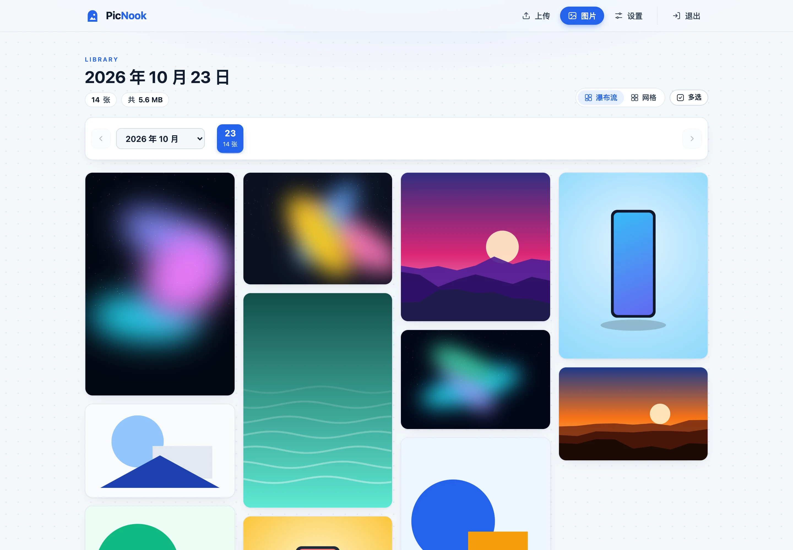
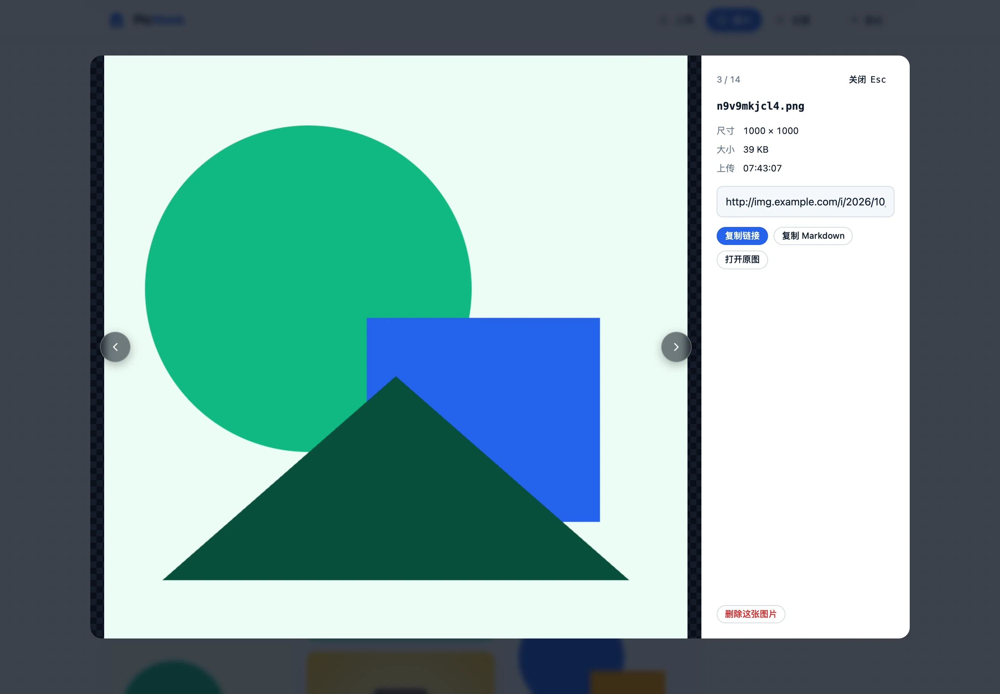
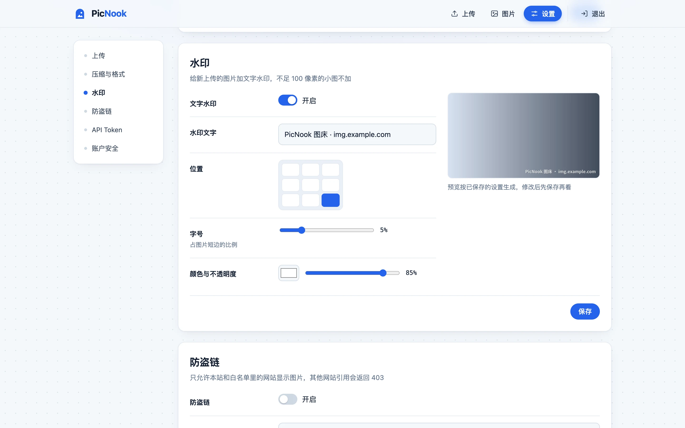
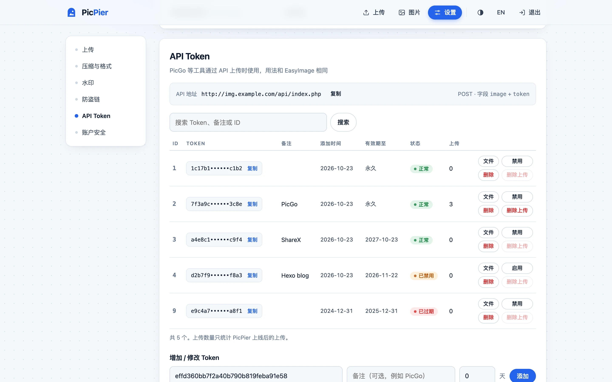
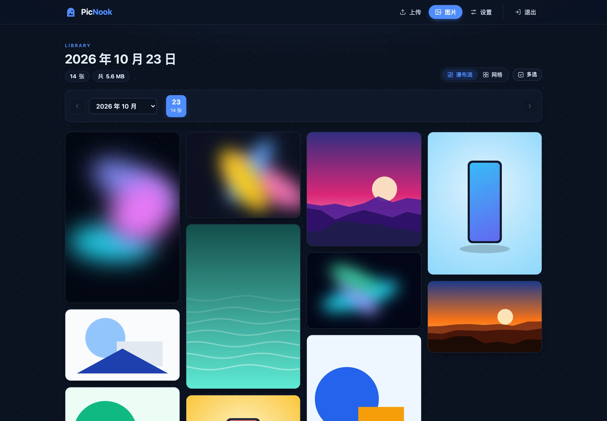
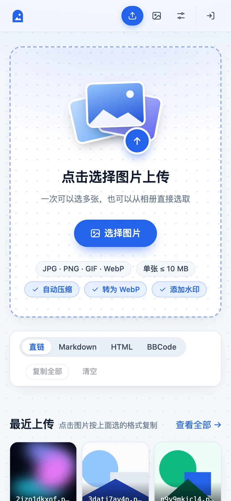
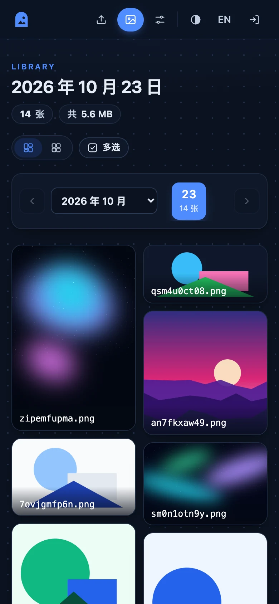

<p align="center"></p>

<h1 align="center">PicPier · 图栈</h1>

<p align="center"><b>图片停靠的栈桥</b> · 不依赖 PHP 和数据库的轻量自托管图床</p>

<p align="center"><b>简体中文</b> · <a href="README.en.md">English</a></p>

<p align="center">
  <a href="https://github.com/Lau0x/picpier/releases/latest"></a>
  <a href="LICENSE"></a>
  <a href="https://github.com/Lau0x/picpier/pkgs/container/picpier"></a>
  
  
</p>

<p align="center">
  <a href="#快速开始docker全新安装">快速开始</a> ·
  <a href="#从-easyimage-迁移">从 EasyImage 迁移</a> ·
  <a href="#后台设置">后台设置</a> ·
  <a href="#上传工具配置">PicGo 配置</a> ·
  <a href="#界面预览">界面预览</a>
</p>

<p align="center"></p>

PicPier 是一个给自己存图、贴图用的图床。一个程序文件或一个 Docker 容器就能跑起来，不需要 PHP、数据库或任何运行环境。拖进去一张图，拿到一条链接，写博客、发帖、做公众号排版时随手就能用。

正在用 [EasyImage 2.0](https://github.com/icret/EasyImages2.0) 的话，可以直接换过来：PicPier 沿用原来的图片目录，**已经贴出去的图片链接一个都不会断**，PicGo 等上传工具也不用改配置，见[从 EasyImage 迁移](#从-easyimage-迁移)。

## 功能

**上传与分享**
- 拖拽、粘贴截图、多选上传，带进度条，最多同时传 3 张
- 一键复制直链 / Markdown / HTML / BBCode，批量上传后可以一次复制全部
- 上传页显示最近上传，点一下就复制
- 兼容 EasyImage 的上传 API（`/api/index.php`，字段 `image` + `token`），PicGo、ShareX 等工具直接用

**图片处理**
- 上传时自动压缩、统一转 WebP，处理后变大就保留原图
- 文字水印，内置思源黑体常用 6763 字，中文开箱即用，带实时预览
- 照片按 EXIF 自动转正，重新编码时去掉拍摄地点等信息

**管理**
- 按日期浏览，瀑布流按原始比例排列，也可以切换成网格
- 多选后批量复制链接或批量删除，大图预览支持键盘左右切换
- 删除的图片进回收目录，误删可以找回
- API Token：有效期、禁用、按 token 查看和删除它上传的图片，一键导入 EasyImage 的 token

**安全**
- 不执行任何上传的内容，按文件内容判断格式，伪装成图片的脚本会被拒绝
- 防盗链：Referer 白名单，支持通配子域名
- 后台密码加盐哈希保存，改密码后其他设备自动下线；登录失败过多会临时锁定

**部署**
- 单个可执行文件，Docker 镜像约 25 MB，支持 amd64 和 arm64
- 界面支持中文和英文，按浏览器语言自动选择，右上角可以手动切换
- 浅色 / 深色模式默认跟随系统，也可以手动切换；手机上也能正常使用

> PicPier 是独立开发的项目，与 EasyImage 及其作者 [icret](https://github.com/icret) 没有关联。它兼容 EasyImage 的目录结构和上传 API，是为了方便迁移，代码没有复用 EasyImage 的任何部分。

## 界面预览

<table>
  <tr>
    <td width="50%"><p align="center">图片管理：按日期浏览，瀑布流排列</p></td>
    <td width="50%"><p align="center">大图预览：尺寸、大小、一键复制</p></td>
  </tr>
  <tr>
    <td><p align="center">水印设置：内置中文字体，实时预览</p></td>
    <td><p align="center">API Token：有效期、禁用、上传统计</p></td>
  </tr>
  <tr>
    <td><p align="center">深色模式：跟随系统，也可以手动切换</p></td>
    <td><p align="center"> </p><p align="center">手机上也能正常使用</p></td>
  </tr>
</table>

## 为什么不用 PHP

2026 年 10 月公开的 PHP 核心漏洞 PHP2Shell（CVE-2026-109618 / CVE-2026-109619）可以在未登录的情况下远程执行代码。CISA 的通告说，所有处理网页请求的 PHP 都受影响，而且已经有人在实际利用（[CISA 通告](https://www.cisa.gov/news-events/alerts/2026/10/21/critical-vulnerabilities-php-require-immediate-patching)）。

EasyImage 2.8.6 及以下版本自身也有任意文件上传（[CVE-2025-65471](https://osv.dev/vulnerability/CVE-2025-65471)）和通过文件重命名执行代码（[CVE-2025-65474](https://nvd.nist.gov/vuln/detail/CVE-2025-65474)）等漏洞。截至 2026 年 10 月，没有查到官方的修复版本。

图床本质上只需要"收文件、存文件、发文件"。PicPier 用 Go 实现这三件事，彻底去掉 PHP，读图片则完全交给 Nginx / OpenResty 当静态文件返回。

## 快速开始（Docker，全新安装）

```bash
mkdir picpier && cd picpier
curl -fsSLO https://raw.githubusercontent.com/Lau0x/picpier/main/docker-compose.yml
curl -fsSL https://raw.githubusercontent.com/Lau0x/picpier/main/.env.example -o .env
mkdir -p data && sudo chown 1000:1000 data
```

生成签名密钥，再生成一个 API token（给 PicGo 等工具用）：

```bash
sed -i "s/^PICPIER_SECRET=.*/PICPIER_SECRET=$(openssl rand -hex 32)/" .env
sed -i "s/^PICPIER_TOKENS=.*/PICPIER_TOKENS=$(openssl rand -hex 16)/" .env
```

然后编辑 `.env`，把 `PICPIER_BASE` 改成你的图床网址，`PICPIER_PASSWORD` 填一个足够长的后台密码。

```bash
chmod 600 .env
docker compose up -d
docker compose ps        # STATUS 显示 healthy 就是正常
```

容器只监听本机的 `127.0.0.1:18321`，还需要用 Nginx / OpenResty / Caddy 反向代理并配置 HTTPS，见下面的[反向代理](#反向代理)。

## 从 EasyImage 迁移

整个迁移不复制、不改动任何图片文件。新程序直接读写原来的 `i` 目录，所以旧链接自然有效；中途出问题，随时可以换回 EasyImage。

EasyImage 常见两种部署方式，迁移方法不同：

- **Docker 版**（`docker ps` 能看到 `ddsderek/easyimage` 之类的镜像）：看下面的 [Docker 版 EasyImage](#docker-版-easyimage)，最简单，反向代理一行都不用改。
- **PHP 站点**（1Panel、宝塔等面板里建的 PHP 网站）：从 [1. 备份](#1-备份) 开始按步骤来。

### Docker 版 EasyImage

思路是把 PicPier 放进 EasyImage 原来的目录，直接使用原来的 `i` 目录，并接替原来的端口，所以 Nginx Proxy Manager 等反向代理不用改。下面以原目录 `/root/data/docker_data/img.example.com` 为例，里面有 `docker-compose.yml`、`config`、`i`，可能还有 `images`：

```bash
cd /root/data/docker_data/img.example.com

# 1. 备份
tar czf ~/easyimage-backup-$(date +%F).tgz .

# 2. 检查有没有被植入后门：列出不是图片的文件（EasyImage 自己的缓存目录除外）。有输出先停下来排查
find i images -type f ! -path 'i/cache/*' ! -path 'i/thumbnails/*' ! -iregex '.*\.\(jpe?g\|png\|gif\|webp\|bmp\|ico\|avif\|svg\)' 2>/dev/null

# 3. 记下两样东西：图片目录的属主，和 EasyImage 对外的端口（PORTS 一列冒号左边的数字）
stat -c '%u:%g' i
docker compose ps

# 4. 停掉 EasyImage（只停止，不删除），旧文件改名留作回滚
docker compose stop
mv docker-compose.yml docker-compose.easyimage.yml
mv config config.easyimage
sed -i 's#\./config:#./config.easyimage:#' docker-compose.easyimage.yml
```

新建 `docker-compose.yml`，`user` 填第 3 步看到的属主，`ports` 左边填 EasyImage 原来的端口；没有 `images` 目录就删掉那一行：

```yaml
name: picpier

services:
  picpier:
    image: ghcr.io/lau0x/picpier:latest
    container_name: picpier
    restart: unless-stopped
    user: "1000:1000"
    env_file: .env
    ports:
      - "9000:18321"
    volumes:
      - ./i:/data/i
      - ./images:/data/images:ro
      - ./i-trash:/data/i-trash
      - ./config:/data/config
```

`name: picpier` 不要省略。否则 Docker 会按目录名把它和旧的 easyimage 容器当成同一个项目，提示"孤儿容器"，用了 `--remove-orphans` 还会把旧容器删掉。

再下载 `.env.example` 存为 `.env` 并填好：

```bash
curl -fsSL https://raw.githubusercontent.com/Lau0x/picpier/main/.env.example -o .env
```

- `PICPIER_BASE`：原来的图床网址
- `PICPIER_PASSWORD`、`PICPIER_SECRET`：后台密码和签名密钥（`openssl rand -hex 32`）
- `PICPIER_EXTRA_DIRS=images=/data/images`：有 `images` 目录时加上
- `PICPIER_TRUSTED_PROXIES`：反向代理在另一台服务器时，按 `.env.example` 里的说明把它的 IP 加上
- `PICPIER_IMAGE_CORS=off`：反向代理已经加了跨域头时设置，见[跨域头只能有一个](#跨域头只能有一个)

然后启动：

```bash
mkdir -p i-trash config && sudo chown <第3步的属主> i-trash config
chmod 600 .env
docker compose up -d
docker compose ps        # STATUS 显示 healthy 就是正常
```

最后打开图床网址登录后台，进入「设置 → API Token → 从 EasyImage 导入」，粘贴 `config.easyimage/api_key.php` 的内容，再按 [7. 验证](#7-验证) 检查一遍。

回滚到 EasyImage：

```bash
docker compose down && docker compose -f docker-compose.easyimage.yml up -d
```

观察几天没问题后，可以删掉旧容器（文件保留）：`docker compose -f docker-compose.easyimage.yml down`。

### PHP 站点

下面用 `<站点根目录>` 指 EasyImage 所在目录，也就是里面有 `i`、`config`、`api` 等文件夹的那个目录。常见位置：

| 环境 | 宿主机上的站点根目录 |
| --- | --- |
| 1Panel | `/opt/1panel/apps/openresty/openresty/www/sites/<域名>/index` |
| 宝塔 | `/www/wwwroot/<域名>` |
| 自己装的 Nginx | 看站点配置里的 `root` |

### 1. 备份

```bash
tar czf ~/easyimage-backup-$(date +%F).tgz -C <站点根目录> .
```

### 2. 检查有没有被植入后门

EasyImage 的漏洞允许上传可执行文件。迁移前先看看图片目录里有没有不是图片的东西：

```bash
find <站点根目录>/i -type f ! -iregex '.*\.\(jpe?g\|png\|gif\|webp\|bmp\|ico\|avif\|svg\)'
```

如果有输出（尤其是 `.php`、`.phtml`、`.phar`），说明服务器可能已经被入侵。这时不要只换程序，要把服务器当作已失陷处理：排查其他站点、改掉所有密码和密钥，必要时重装系统。

picpier 部署后不会执行、也不会输出这些文件，但在宿主机上它们仍然存在。

### 3. 准备好原来的 API Token

如果你在用 PicGo、ShareX 等工具通过 API 上传，先把原来的 token 文件内容复制出来，第 7 步要粘贴到新后台里：

```bash
cat <站点根目录>/config/api_key.php
```

导入后，原来的 ID、添加时间和有效期都会保留，工具那边什么都不用改。

### 4. 查看图片目录的属主

```bash
stat -c '%u:%g' <站点根目录>/i
```

记下输出的两个数字，比如 `1000:1000`，下一步要用。新程序必须用同一个用户身份运行，才能往原来的目录里写新图片。

### 5. 启动 picpier

**方式一：Docker（推荐）**

```bash
mkdir ~/picpier && cd ~/picpier
curl -fsSLO https://raw.githubusercontent.com/Lau0x/picpier/main/docker-compose.yml
curl -fsSL https://raw.githubusercontent.com/Lau0x/picpier/main/.env.example -o .env
```

编辑 `docker-compose.yml`，把 `volumes` 改成挂载原来的 `i` 目录：

```yaml
    volumes:
      - <站点根目录>/i:/data/i
      - ./i-trash:/data/i-trash
      - ./config:/data/config
```

`config` 目录保存后台设置、token 和上传记录，一定要挂载出来，否则重建容器后会丢失。

站点根目录下如果还有 `images` 目录（EasyImage 早期版本用的，链接形如 `/images/2021/...`），再加一行只读挂载，并在 `.env` 里加上 `PICPIER_EXTRA_DIRS=images=/data/images`，这些旧链接也能继续打开：

```yaml
      - <站点根目录>/images:/data/images:ro
```

编辑 `.env`：`PICPIER_BASE` 填原来的图床网址（比如 `https://img.example.com`），`PICPIER_UID` / `PICPIER_GID` 填第 4 步看到的数字，再填好密码和密钥。`PICPIER_TOKENS` 可以留空。然后：

```bash
mkdir -p i-trash config && sudo chown <第4步的数字> i-trash config
chmod 600 .env
docker compose up -d
curl -s http://127.0.0.1:18321/healthz     # 输出 ok 就是正常
```

**方式二：直接运行（systemd）**

从 [Releases](https://github.com/Lau0x/picpier/releases) 下载对应架构的程序（`uname -m` 显示 `x86_64` 选 amd64，`aarch64` 选 arm64）：

```bash
sudo install -m 755 picpier-linux-amd64 /usr/local/bin/picpier
sudo cp .env.example /etc/picpier.env && sudo chmod 600 /etc/picpier.env   # 然后编辑填好
sudo mkdir -p <站点根目录>/i-trash <站点根目录>/picpier-config
sudo chown <第4步的数字> <站点根目录>/i-trash <站点根目录>/picpier-config
```

把 [deploy/picpier.service](deploy/picpier.service) 复制到 `/etc/systemd/system/`，把里面的路径改成你的 `<站点根目录>`，`User` / `Group` 改成图片目录的属主。然后：

```bash
sudo systemctl daemon-reload
sudo systemctl enable --now picpier
curl -s http://127.0.0.1:18321/healthz
```

### 6. 改反向代理，下线 PHP

按下面的[反向代理](#反向代理)替换站点配置。**一定要删掉原来所有 PHP 相关的配置**，包括 `location ~ \.php$`、`fastcgi_pass`、`include enable-php-*.conf` 和 `index index.php`。只要还留着一条，PHP 请求就会被交给 PHP 处理，绕过 picpier。

```bash
nginx -t && nginx -s reload          # 1Panel 在面板里保存配置会自动重载
```

### 7. 验证

```bash
# 旧图片：应返回 200 和 image/...
curl -sI https://img.example.com/i/<一张旧图的路径> | head -3
# 上传目录里的脚本：应返回 404
curl -s -o /dev/null -w '%{http_code}\n' https://img.example.com/i/test.php
# API 和 token：只带 token 不带图片，不会写入文件。应返回 "没有选择上传的文件"；返回 "Token 错误" 说明 token 没导入
curl -s -F token=<你的token> https://img.example.com/api/index.php
```

再打开 `https://img.example.com` 用新密码登录，进入「设置 → API Token → 从 EasyImage 导入」，粘贴第 3 步复制的 `api_key.php` 内容并导入（导入后再跑一次上面的 API 检查），然后用网页和 PicGo 各传一张图确认。压缩、WebP、水印、防盗链也在「设置」里按需开启。

### 8. 清理

确认一切正常后：

- 停掉这个站点的 PHP（1Panel 里删除或停用对应的 PHP 运行环境；宝塔里把站点的 PHP 版本改成"纯静态"）
- 把 EasyImage 的程序文件移出站点目录，只保留 `i` 目录。备份已经在第 1 步做过了
- 服务器上如果还有其他 PHP 站点，把 PHP 升级到修复版本（8.5.12 / 8.4.27 / 8.3.36 / 8.2.35 或更高）

### 迁移后的差异

| 项目 | 情况 |
| --- | --- |
| `/i/...` 图片链接 | 不变 |
| 开启"隐藏 /i/ 路径"后的 `/年/月/日/文件名` 链接 | 不变 |
| 早期版本的 `/images/...` 链接 | 不变，需要设置 `PICPIER_EXTRA_DIRS` |
| `thumb.php?img=...` 缩略图链接 | 跳转到原图 |
| `/api/index.php` 上传 | 不变，返回格式一致 |
| 原来的删除链接 `del.php?hash=...` | **失效**，新上传的图片会返回新的删除链接 |
| API Token（ID、有效期、禁用） | 支持，可从 `api_key.php` 一键导入 |
| 压缩、转 WebP、文字水印、防盗链 | 支持，在后台「设置」里开启 |
| 原图保护 `hide.php?key=...` 链接 | **不支持**，开过这个功能的旧链接会失效 |
| 图片水印、鉴黄、FTP 同步、游客上传、多用户 | 不支持 |
| 上传格式 | 新上传只接受 jpg / png / gif / webp；旧的 bmp / ico / svg 等仍可访问 |

## 反向代理

完整配置见 [deploy/nginx.conf](deploy/nginx.conf)，Nginx 和 OpenResty 通用。核心是三段：

```nginx
client_max_body_size 12m;

# 图片由 Nginx 直接返回，不经过任何程序；图片以外的文件一律 404
location ^~ /i/ {
    root <OpenResty 看到的站点根目录>;
    location ~* \.(jpe?g|png|gif|webp|bmp|ico|avif)$ { expires 30d; try_files $uri =404; }
    return 404;
}

# 旧的 .php 地址（api/index.php、thumb.php）交给 picpier 处理
location ~* \.php$ { proxy_pass http://127.0.0.1:18321; proxy_set_header Host $host; proxy_set_header X-Real-IP $remote_addr; }

location / { proxy_pass http://127.0.0.1:18321; proxy_set_header Host $host; proxy_set_header X-Real-IP $remote_addr; }
```

几点说明：

- **1Panel**：OpenResty 跑在容器里，`root` 要写容器内的路径 `/www/sites/<域名>/index`，不是宿主机的 `/opt/1panel/...`。1Panel 的 OpenResty 默认使用 host 网络，`127.0.0.1:18321` 可以直接访问。
- **全新安装**：如果图片不在 Nginx 能读到的目录里，可以省掉 `/i/` 那一段，全部反代给 picpier，由它自己返回图片。这样更简单，只是性能稍差。
- **`Host` 和 `X-Real-IP` 两行不能少**：前者用于防跨站提交的来源校验，后者用于登录限流按真实 IP 计数。
- **Caddy**：`reverse_proxy 127.0.0.1:18321` 即可，Caddy 默认会传递 Host。需要额外加 `header_up X-Real-IP {remote_host}`。

### Nginx Proxy Manager

在 Proxy Host 里把域名转发到 PicPier 即可，图片也由 PicPier 返回，不需要上面的 Nginx 配置。NPM 默认会传递 `Host` 和 `X-Real-IP`。需要注意三点：

- **端口**：仓库里的 `docker-compose.yml` 默认只监听本机 `127.0.0.1:18321`。NPM 跑在别的服务器上，或者跑在 Docker 里访问不到宿主机的 127.0.0.1 时，把 `ports` 改成 `"18321:18321"`（或接替原来的端口），并用防火墙限制只允许 NPM 所在的 IP 访问。
- **可信代理**：NPM 和 PicPier 在同一台机器的 Docker 里时不用改；NPM 在另一台服务器时，要把它的 IP 加进 `PICPIER_TRUSTED_PROXIES`。否则所有访客都会被当成同一个 IP，有人连续输错几次密码，所有人都会被锁在后台外面 15 分钟。
- **自定义配置**：如果在 Custom Nginx Configuration 里加了 `Access-Control-Allow-Origin`，要设置 `PICPIER_IMAGE_CORS=off`，见下面的[跨域头只能有一个](#跨域头只能有一个)。

### 防盗链

防盗链由程序根据 `Referer` 判断，所以图片请求必须经过 PicPier 才会生效：

- **反向代理把所有请求都转给 PicPier**（Nginx Proxy Manager、Caddy、宝塔反代等的常见用法）：不需要任何修改，在后台开启即生效。
- **按上面的推荐配置让 Nginx 直接返回 `/i/` 下的图片**：请求不经过 PicPier，需要把 `/i/` 也交给程序处理：

```nginx
location ^~ /i/ {
    proxy_pass http://127.0.0.1:18321;
    proxy_set_header Host $host;
    proxy_set_header X-Real-IP $remote_addr;
}
```

程序同样只输出图片扩展名的文件，不执行任何脚本。

另外，反向代理或 CDN 的图片缓存（例如 Nginx Proxy Manager 的 Cache Assets）要关掉，否则缓存命中时请求不经过 PicPier，防盗链会被绕过。开启后响应会带 `Vary: Referer`；如果前面还有 CDN，需要确认 CDN 按 Referer 区分缓存，或者在 CDN 上配置防盗链。

### 跨域头只能有一个

PicPier 默认会给图片加 `Access-Control-Allow-Origin: *`，方便公众号排版工具、在线编辑器等网页用脚本读取图片。

如果反向代理也加了这个头，响应里就会出现两个值。浏览器会判定跨域失败，这类工具会提示"图床缺少跨域头"之类的错误，但在网页里直接显示图片不受影响，所以很容易被忽略。常见情况是在 Nginx Proxy Manager 的 Custom Nginx Configuration（或 Nginx 的站点配置）里写了：

```nginx
add_header Access-Control-Allow-Origin "*" always;
```

两边只保留一个即可，二选一：

- **保留反向代理的**：在 `.env` 里设置 `PICPIER_IMAGE_CORS=off`，然后 `docker compose up -d`。适合代理里还配了 `Cross-Origin-Resource-Policy` 等其他头、想统一在代理里管理的情况。
- **保留 PicPier 的**：删掉反向代理里的这一行，`PICPIER_IMAGE_CORS` 保持默认的 `on`。

检查方法：下面这条命令应该只输出一行；输出两行说明重复了，一行都没有说明两边都关掉了。

```bash
curl -sI -H 'Origin: https://example.com' https://img.example.com/i/<任意一张图> | grep -i access-control-allow-origin
```

上传接口 `/api/index.php` 的跨域头始终由 PicPier 处理，不受这个开关影响。如果反向代理也给 API 加了跨域头，同样会出现重复，需要在代理里把 `/api/` 排除掉。

## 后台设置

登录后点右上角「设置」，修改后立即生效，保存在配置目录的 `settings.json` 里。

| 分类 | 说明 |
| --- | --- |
| 上传 | 单张大小上限。调大时 Nginx 的 `client_max_body_size` 也要跟着改 |
| 压缩与格式 | 压缩质量推荐 80–90，肉眼基本看不出差别；可以把 JPG / PNG 统一转成 WebP。动图和超过 4000 万像素的图片原样保存；处理后反而变大时也保留原图 |
| 水印 | 文字、九宫格位置、字号（占图片短边的百分比）、颜色、不透明度，带实时预览。内置思源黑体粗体（GB2312 的 6763 个常用汉字），中文水印开箱即用；要用生僻字或换字体时可以上传 ttf / otf / ttc |
| 防盗链 | Referer 白名单，`*.example.com` 匹配所有子域名；可选是否允许没有 Referer 的访问 |
| API Token | 新增、修改有效期、禁用、删除；查看某个 token 上传的图片，一键删除它的全部上传；从 EasyImage 的 `api_key.php` 导入 |
| 账户安全 | 修改后台登录密码。新密码加盐哈希（PBKDF2-SHA256）后保存在 `settings.json`，会覆盖 `PICPIER_PASSWORD`；改完后其他设备上的登录全部失效 |

几点说明：

- 压缩、转格式、水印只对新上传的图片生效，不会改动已有图片。
- 重新编码会去掉照片的 EXIF 信息（包括拍摄地点），方向会先按 EXIF 转正。
- 上传数量按配置目录里的 `uploads.log` 统计，只包含本程序上线后的上传。

### 界面语言和主题

界面有中文和英文两套，默认按浏览器语言选择（`zh` 开头用中文，其他用英文），右上角的「EN / 中」按钮可以手动切换并记住。旁边的主题按钮在跟随系统、浅色、深色之间切换。

API 返回的 `message` 始终是中文，和 EasyImage 保持一致，已有的工具和脚本不受影响。

### 忘记密码

- 没在后台改过密码：密码就是 `.env` 里的 `PICPIER_PASSWORD`，用 `grep PICPIER_PASSWORD .env` 查看。
- 在后台改过密码：在 `docker-compose.yml` 所在目录执行下面两条命令，清除后台设置的密码并重启，然后用 `PICPIER_PASSWORD` 登录。其他设置和 token 都会保留。

```bash
docker compose exec picpier /picpier reset-password
docker compose restart
```

直接运行（systemd）的话，执行 `picpier reset-password <配置目录>`，再 `sudo systemctl restart picpier`。

## 上传工具配置

**PicGo**：安装"自定义 Web 图床"插件（web-uploader），然后这样填：

| 项目 | 值 |
| --- | --- |
| API 地址 | `https://img.example.com/api/index.php` |
| POST 参数名 | `image` |
| JSON 路径 | `url` |
| 自定义 Body | `{"token":"你的token"}` |

原来已经配置过 EasyImage 的，不需要改。

**curl / 脚本**：

```bash
curl -F image=@photo.jpg -F token=你的token https://img.example.com/api/index.php
# 也可以用请求头传 token
curl -H "Authorization: Bearer 你的token" -F image=@photo.jpg https://img.example.com/api/upload
```

返回：

```json
{"result":"success","code":200,"url":"https://img.example.com/i/2026/10/22/k88e7pabcd.jpg","srcName":"photo","thumb":"...","del":"https://img.example.com/del?f=...&s=...","message":"success"}
```

通过 API 上传时会多返回 `"id"`，即 token 的 ID，和 EasyImage 一致。

失败时 `result` 为 `failed`，`code` 含义：`202` token 错误、已过期或已禁用（具体原因见 `message`），`204` 没有文件，`400` 格式不支持或文件过大，`500` 服务器保存失败。

## 升级

Docker 镜像有三种标签：

| 标签 | 含义 |
| --- | --- |
| `latest` | 最新的正式版本，推荐使用 |
| `0.4.3` 这类版本号 | 固定在某个版本，升级时要手动改版本号 |
| `edge` | main 分支的最新代码，可能包含还没发布的改动，不建议正式使用 |

用 `latest` 时，在 `docker-compose.yml` 所在目录执行：

```bash
docker compose pull && docker compose up -d
```

图片、设置和 token 都在挂载的目录里，升级不会丢。新版本有问题时，把 `latest` 改成之前的版本号再执行一次就能回退。每个版本的改动见 [Releases](https://github.com/Lau0x/picpier/releases)。

直接运行（systemd）的话，从 Releases 下载新的程序文件替换 `/usr/local/bin/picpier`，再执行 `sudo systemctl restart picpier`。

### 从 PicNook 升级

PicPier 原名 PicNook，从 v0.9.0 起改名。已经部署了 PicNook 的，升级时只需要把 `docker-compose.yml` 里的镜像改成 `ghcr.io/lau0x/picpier:latest`，旧镜像 `ghcr.io/lau0x/picnook` 不再更新：

```bash
docker compose down
sed -i 's#ghcr.io/lau0x/picnook#ghcr.io/lau0x/picpier#; s/^name: picnook/name: picpier/; s/container_name: picnook/container_name: picpier/' docker-compose.yml
docker compose pull && docker compose up -d
```

- `.env` 里的 `PICNOOK_` 变量仍然有效，可以不改；想改的话把前缀统一换成 `PICPIER_`，启动日志里会提示还在用的旧变量名。
- 直接运行时，配置目录 `picnook-config` 会继续沿用，不需要改名。
- 登录 Cookie 改了名字，升级后需要重新登录一次。

## 配置项

所有配置都可以用环境变量设置；直接运行时也可以用命令行参数，参数优先于环境变量。

| 环境变量 | 命令行参数 | 默认值 | 说明 |
| --- | --- | --- | --- |
| `PICPIER_BASE` | `-base` | 无，必填 | 图床对外网址，返回的链接以它开头 |
| `PICPIER_PASSWORD` | 无 | 无，必填 | 后台密码，至少 8 位。在后台「设置 → 账户安全」改过密码后，以后台的为准 |
| `PICPIER_SECRET` | 无 | 无，必填 | 签名密钥，至少 32 个字符。更换后所有人需要重新登录，旧的删除链接失效 |
| `PICPIER_TOKENS` | 无 | 空 | API token，逗号分隔。只在首次启动时导入后台，之后在后台管理 |
| `PICPIER_IMAGES` | `-images` | Docker 内为 `/data/i` | 图片目录，对应网址里的 `/i/` |
| `PICPIER_TRASH` | `-trash` | 图片目录旁的 `i-trash` | 删除的图片移到这里 |
| `PICPIER_CONFIG_DIR` | `-config-dir` | 图片目录旁的 `picpier-config`，Docker 内为 `/data/config` | 后台设置、token、上传记录和水印字体 |
| `PICPIER_EXTRA_DIRS` | `-extra-dirs` | 空 | 只读的旧图片目录，格式 `前缀=目录`，逗号分隔，例如 `images=/data/images`。只输出图片，不能上传或删除 |
| `PICPIER_IMAGE_CORS` | `-image-cors` | `on` | 图片响应是否带 `Access-Control-Allow-Origin: *`。如果反向代理（例如 Nginx Proxy Manager 的自定义配置）已经加了这个头，设为 `off`，否则会出现两个值，浏览器会判定跨域失败 |
| `PICPIER_MAX_MB` | `-max-mb` | `10` | 单张图片大小上限（MB）的初始值，之后在后台修改 |
| `PICPIER_LISTEN` | `-listen` | `127.0.0.1:18321`，Docker 内为 `:18321` | 监听地址 |
| `PICPIER_TRUSTED_PROXIES` | `-trusted-proxies` | `127.0.0.0/8,::1/128`，Docker 内另加私有网段 | 设置后替换默认值，不是追加。只有来自这些地址的请求，才会采信 `X-Real-IP` |

## 安全设计

- **不执行任何上传的内容**：没有 PHP，图片以静态文件返回，并带 `X-Content-Type-Options: nosniff`；SVG 额外加了 `sandbox` 的 CSP，里面的脚本不会执行
- **按文件内容判断格式**：不信任文件名和 `Content-Type`，读取文件头并解码图片尺寸，伪装成图片的脚本会被拒绝；文件名由服务端随机生成
- **路径校验**：拒绝 `..`、绝对路径、反斜杠和以点开头的路径段；只输出图片扩展名的文件，不列目录
- **登录**：登录状态用 HMAC 签名的 Cookie（HttpOnly、SameSite=Lax、HTTPS 下带 Secure）；同一 IP 15 分钟内连续输错 5 次锁定
- **防跨站提交**：带 Cookie 的写操作都会校验 `Origin` / `Referer`
- **删除**：API 返回的删除链接有签名，打开后只显示确认页，点确认才删；删除是移到回收目录
- **超大图片**：超过 4000 万像素的图片不解码处理，最多同时处理 2 张，避免被恶意大图撑爆内存
- **最小权限**：Docker 镜像基于 distroless，没有 shell，以非 root 运行；systemd 配置启用了 `ProtectSystem=strict` 等沙箱选项，只开放图片目录的写权限

发现安全问题请通过 GitHub 的 [Security Advisories](https://github.com/Lau0x/picpier/security/advisories/new) 私下报告，不要直接开 issue。

## 从源码构建

需要 Go 1.26 或以上版本。依赖只有 `golang.org/x/image`（字体渲染）和 [gen2brain/webp](https://github.com/gen2brain/webp)（WebP 编码，由官方 libwebp 转译成的纯 Go 代码，不需要 CGO）。

```bash
git clone https://github.com/Lau0x/picpier.git && cd picpier
CGO_ENABLED=0 go build -tags nodynamic -o picpier .
bash test/e2e.sh          # 端到端测试：模拟 EasyImage 站点，检查兼容性和安全项
docker build -t picpier .  # 构建镜像
```

## License

[MIT](LICENSE)

内置的水印字体 `fonts/NotoSansSC-Bold-GB2312.otf` 是从 [Noto Sans CJK](https://github.com/notofonts/noto-cjk)（思源黑体）SC 粗体中截取 GB2312 字符集得到的，遵循 [SIL Open Font License 1.1](fonts/OFL.txt)。
